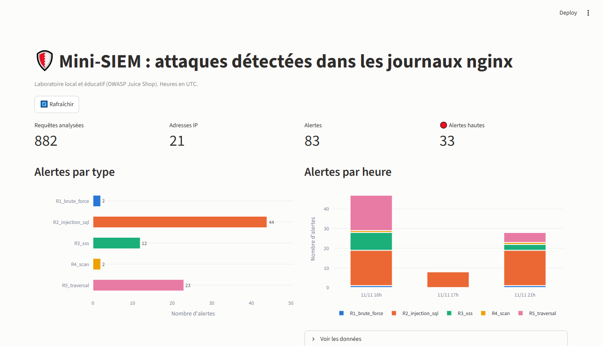
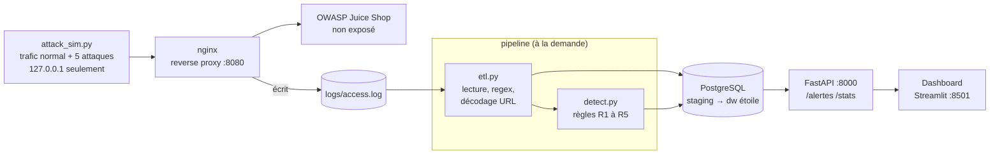
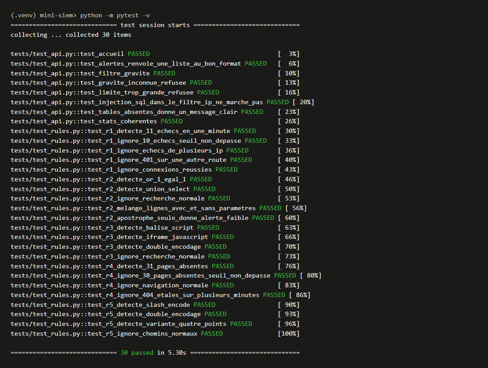
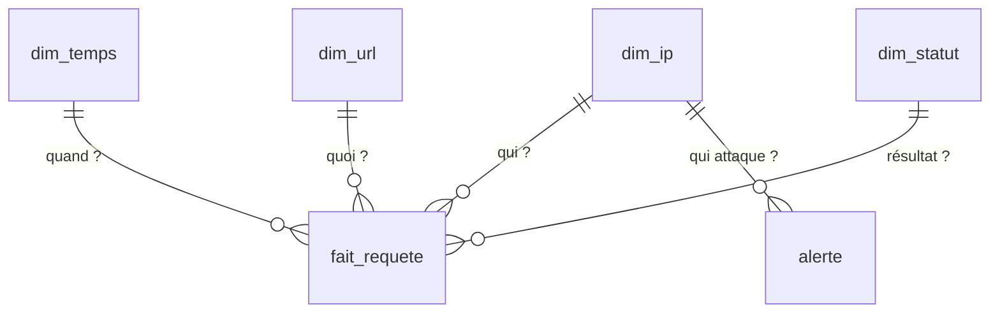
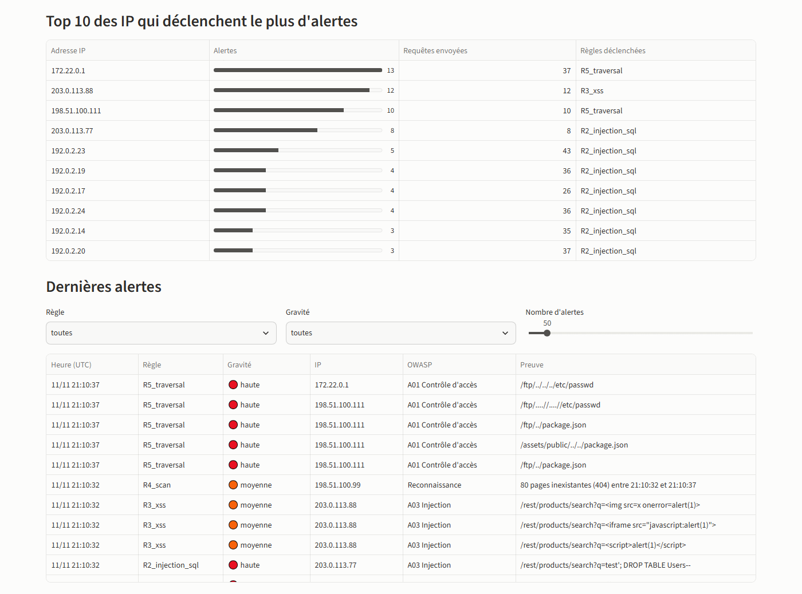
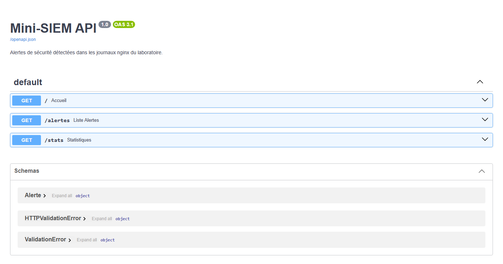

# Mini-SIEM : détecter des attaques web dans des journaux nginx

Projet personnel (2026) qui relie **données**, **cybersécurité** et **développement** :
des journaux de connexion nginx sont chargés par un **ETL Python** dans un **entrepôt
PostgreSQL en étoile**, analysés par **5 règles de détection testées**, puis exposés par
une **API FastAPI** et un **dashboard Streamlit**. Tout se lance avec Docker Compose.

> ⚠️ **Projet éducatif.** Toutes les attaques sont simulées **uniquement contre un
> laboratoire local** (OWASP Juice Shop, application volontairement vulnérable) sur
> `127.0.0.1`. Le script de test refuse toute autre cible. Attaquer un système sans
> autorisation écrite est illégal. Ce projet n'est ni un outil de pentest ni un vrai SOC.



| | |
|---|---|
| **Stack** | Docker Compose, nginx, OWASP Juice Shop, Python 3.12 (pandas, requests), PostgreSQL 16, FastAPI, Streamlit, Plotly, pytest |
| **Volume testé** | 882 requêtes, 21 IP, 83 alertes (dont 33 hautes) |
| **Tests** | 30 tests pytest (22 sur les règles, 8 sur l'API) |

## Architecture



1. `attack_sim.py` envoie du trafic normal et des attaques simulées au labo.
2. **nginx** transmet les requêtes à Juice Shop et écrit une ligne par requête dans `access.log`.
3. `etl.py` lit le journal, découpe chaque ligne, **décode les URL** (`%27` → `'`) et charge
   `staging.access_log`, puis remplit le schéma en étoile `dw`.
4. `detect.py` applique les règles et écrit la table `dw.alerte`.
5. **FastAPI** expose les alertes ; **Streamlit** les affiche (sans connaître le mot de passe de la base).

## Démarrage rapide

**Prérequis :** Docker Desktop, Python 3.12, Git.

```bash
git clone https://github.com/AYOUBSK7/mini-siem.git
cd mini-siem
copy .env.example .env          # Linux / macOS : cp .env.example .env
```
Ouvrir `.env` et remplacer `changez_moi` par un mot de passe de votre choix.

```bash
# 1. Lancer le labo, l'API et le dashboard (premier lancement : environ 8 min de téléchargement)
docker compose up -d --build

# 2. Installer Python pour le script de trafic et les tests
python -m venv .venv
.venv\Scripts\activate          # Linux / macOS : source .venv/bin/activate
pip install -r requirements.txt

# 3. Générer du trafic normal + les 5 attaques (moins d'une minute)
python app/attack_sim.py

# 4. ETL + détection
docker compose run --rm pipeline

# 5. Lancer les tests
python -m pytest
```

| Adresse | Contenu |
|---|---|
| http://127.0.0.1:8501 | Dashboard |
| http://127.0.0.1:8000/docs | API (documentation interactive) |
| http://127.0.0.1:8080 | Juice Shop, via nginx |

Tous les ports sont liés à `127.0.0.1` : rien n'est accessible depuis le réseau.
Pour tout arrêter : `docker compose down`.

## Règles de détection

| Règle | Scénario simulé | Détection | Gravité | OWASP 2021 |
|---|---|---|---|---|
| **R1** brute force | 20 connexions échouées | plus de 10 réponses **401** sur `/rest/user/login`, même IP, même minute | haute | A07 Authentification |
| **R2** injection SQL | `' OR 1=1--`, `UNION SELECT`… | motifs SQL dans l'URL décodée → haute ; apostrophe seule → faible | haute / faible | A03 Injection |
| **R3** XSS | `<script>`, `<iframe src="javascript:…">` | balises HTML, `javascript:`, `onerror=` | moyenne | A03 Injection |
| **R4** scan | 100 pages inexistantes | plus de 30 réponses **404**, même IP, même minute | moyenne | Reconnaissance |
| **R5** remontée de dossiers | `..%2F`, `%252e%252e%252f`, `....//` | `../` après **double décodage** | haute | A01 Contrôle d'accès |

Chaque règle a ses tests pytest : au moins une ligne de journal qui **doit** déclencher
l'alerte, une ligne normale qui ne doit **pas**, et les seuils testés à la limite
(10 échecs → rien, 11 → alerte).



## Modèle de données



- `staging.access_log` : une ligne du journal découpée en colonnes (avec la ligne brute, comme preuve).
- `dw.fait_requete` : **grain = 1 requête HTTP** ; mesures : taille, nombre de requêtes.
- Dimensions : `dim_temps` (à la minute), `dim_ip`, `dim_url` (famille api / static / ftp / autre), `dim_statut`.
- `dw.alerte` : règle, catégorie OWASP, IP, heure, gravité, preuve.

Exemples d'analyses dans [`sql/requetes_analyse.sql`](sql/requetes_analyse.sql) :
404 par IP et par minute, top 10 des IP, alertes par règle et par heure.



## Résultats sur le laboratoire

| Règle | Alertes | Verdict |
|---|---|---|
| R1 | 2 | ✅ les 2 scénarios détectés, aucune sur les erreurs isolées des visiteurs |
| R2 haute | 8 | ✅ toutes les injections détectées |
| R2 faible | 36 | ⚠️ **faux positifs** : 36 recherches `l'orange` de visiteurs normaux |
| R3 | 12 | ✅ |
| R4 | 2 | ✅ 80 × 404 par minute pour le scanner, 3 au maximum pour un visiteur |
| R5 | 23 | ✅ mais 13 attribuées à l'IP de Docker (voir limites) |

**Aucune alerte haute ne vise un visiteur normal.** Les faux positifs sont tous en gravité
faible, et c'est un choix assumé : une apostrophe seule est souvent légitime, mais l'ignorer
laisserait passer des injections simples.

## Limites

- **Seule l'adresse est visible.** nginx n'écrit pas le corps des requêtes POST : une
  injection envoyée dans un formulaire est invisible, et le brute force n'est détecté que
  par les statuts 401.
- **IP simulées.** Tout le trafic vient de mon PC ; des IP fictives sont envoyées dans
  l'en-tête `X-Forwarded-For`, que nginx accepte de n'importe qui. C'est acceptable en
  labo, mais dangereux en production.
- **Mauvaise IP pour certaines traversées.** Quand le chemin sort de la racine du site,
  nginx répond 400 **avant de lire les en-têtes** : la requête est journalisée avec l'IP
  de Docker (`172.22.0.1`).
- **Fenêtre fixe d'une minute** pour R1 et R4 : 8 échecs à 16:49:55 puis 8 à 16:50:05 ne
  déclenchent rien. Amélioration possible : une fenêtre glissante de 60 s.
- **R4 ne voit que les 404.** Juice Shop renvoie 200 pour une page inconnue comme
  `/admin.php`, donc 20 % du scan n'est pas compté.
- **Traitement par lots**, pas de temps réel ; une alerte par requête suspecte (pas de
  regroupement) ; on ne décode que deux fois l'URL.

## Structure du dépôt

```
mini-siem/
├── docker-compose.yml        labo + api + dashboard + pipeline
├── Dockerfile                image Python commune
├── .env.example              modèle de configuration (sans vrai mot de passe)
├── nginx/nginx.conf          reverse proxy + format du journal
├── app/
│   ├── attack_sim.py         trafic de test (127.0.0.1 seulement)
│   ├── etl.py                access.log → staging → étoile
│   ├── detect.py             règles R1 à R5
│   └── api.py                FastAPI
├── dashboard/dashboard.py    Streamlit
├── sql/                      schema.sql, staging_vers_dw.sql, requetes_analyse.sql
├── tests/                    test_rules.py, test_api.py
└── docs/                     rapport.pdf, GUIDE.md, captures/
```

## Documentation

- [`docs/rapport.pdf`](docs/rapport.pdf) : rapport d'une page (méthode, résultats, limites).
- [`docs/GUIDE.md`](docs/GUIDE.md) : explication détaillée de chaque étape, des choix
  techniques et des problèmes rencontrés.



## Sécurité et éthique

- Aucun mot de passe dans le code : `.env` est ignoré par Git, `.dockerignore` l'exclut
  des images, et le dashboard n'y a pas accès.
- L'API utilise des **requêtes SQL paramétrées** (testé : `?ip=' OR 1=1--` ne renvoie rien).
- Tests uniquement sur un système qui m'appartient ; aucune donnée personnelle réelle.

---
*Auteur : Ayoub BOUSSOUKAYA*
