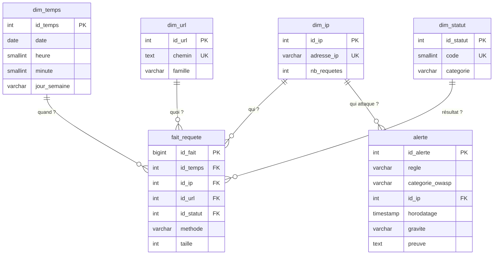

# Guide d'oral : ce que fait chaque étape et pourquoi

Ce fichier explique le projet étape par étape, avec des mots simples, pour pouvoir
répondre aux questions sans notes.

---

## Étape 1 : le laboratoire Docker

### Ce qu'on a fait
Trois conteneurs Docker, décrits dans `docker-compose.yml` :

| Service | Rôle | Accessible depuis le PC ? |
|---|---|---|
| `juiceshop` | Site web **volontairement vulnérable** (OWASP), notre cible | Non, seulement par nginx |
| `nginx` | **Reverse proxy** : reçoit les requêtes, les passe à Juice Shop, écrit `access.log` | Oui, `http://localhost:8080` |
| `postgres` | Entrepôt de données (servira à l'étape ETL) | Oui, port 5433, localhost seulement |

```
navigateur / attack_sim.py  -->  nginx :8080  -->  juiceshop :3000
                                     |
                                     +--> logs/access.log
```

### Les questions qu'on peut me poser

**C'est quoi un reverse proxy ?**
Un serveur placé *devant* l'application. Le client parle à nginx, nginx transmet à
l'application et renvoie la réponse. Ici il sert surtout à **journaliser** chaque
requête, comme en entreprise (nginx, Apache, un load balancer…).

**Pourquoi Juice Shop n'a pas de `ports:` ?**
Pour qu'on ne puisse pas le contourner : toute requête passe par nginx, donc toute
requête est dans le journal. Les conteneurs se parlent par le réseau interne de
Docker, avec leur nom de service (`http://juiceshop:3000`).

**Pourquoi `127.0.0.1:8080:80` et pas `8080:80` ?**
`127.0.0.1` = seulement mon PC. Sans ça, n'importe qui sur le même Wi-Fi pourrait
accéder à une application vulnérable. C'est une exigence du cahier des charges.

**Où est le mot de passe de PostgreSQL ?**
Dans `.env`, qui est dans `.gitignore`, donc jamais publié. Sur GitHub il n'y a que
`.env.example` (un modèle sans vrai mot de passe). `docker compose` lit `.env`
automatiquement et remplace `${PG_PASSWORD}`.

**À quoi ressemble une ligne de `access.log` ?** (format *combined*)
```
198.51.100.7 - - [11/Nov/2026:18:02:11 +0000] "GET /rest/products/search?q=apple HTTP/1.1" 200 1234 "-" "python-requests/2.32"
```
IP · utilisateur (`-`) · date · requête (méthode, chemin, paramètres) · statut HTTP ·
taille de la réponse · page d'origine · navigateur (*user agent*).

**Pourquoi un en-tête `X-Forwarded-For` et le module `realip` ?**
Tout le trafic vient de mon PC, donc nginx verrait toujours la même IP : impossible de
faire un « top 10 des IP ». Le script de test envoie une fausse IP dans
`X-Forwarded-For` (plages réservées à la documentation : `192.0.2.x`,
`198.51.100.x`, `203.0.113.x`) et nginx l'utilise comme IP du client.
**Limite** : en production, on ne fait confiance à cet en-tête que s'il vient d'un
proxy connu, sinon un attaquant peut mentir sur son IP. Ici c'est un labo local.

**Limite importante des journaux**
nginx n'écrit pas le **corps** des requêtes POST. Le mot de passe tapé au login ou une
injection envoyée en POST n'apparaissent donc pas. On voit seulement ce qui est dans
l'**adresse** (chemin + paramètres) et le **statut** (401, 404…). Mes règles de
détection sont donc construites là-dessus.

### Ce que j'ai découvert en testant (à mettre dans le rapport)
Juice Shop est une *Single Page Application* (Angular) : pour une page inconnue comme
`/admin.php`, `/.env` ou `/wp-login.php`, il renvoie la page d'accueil avec le statut
**200**, pas 404. Un scan « classique » ne produit donc presque pas de 404 !

| Requête testée | Statut |
|---|---|
| `/admin.php`, `/.env`, `/backup.zip` | 200 (page d'accueil renvoyée) |
| `/ftp/inconnu.md`, `/api/Products/99999` | **404** |
| `/ftp/inconnu.txt` | 403 (extension interdite) |
| `/rest/inconnu` | 500 |
| `/../../etc/passwd` | 400 (rejeté directement par nginx) |
| `POST /rest/user/login` avec un faux mot de passe | **401** |

Conséquence : une règle « trop de 404 » seule laisserait passer une partie du scan
(faux négatif). On en tient compte en écrivant la règle R4.

### Commandes
```bash
docker compose up -d          # démarrer le labo
docker compose ps             # voir les conteneurs
docker compose logs nginx     # voir les erreurs éventuelles de nginx
docker compose down           # tout arrêter
```

---

## Étape 2 : le générateur de trafic `app/attack_sim.py`

### Ce qu'on a fait
Un script Python (bibliothèque `requests`) qui envoie, **vers le labo local uniquement** :

| Scénario | IP simulée | Ce qu'il envoie | Ce qu'on voit dans le journal |
|---|---|---|---|
| Trafic normal | 15 IP `192.0.2.10` à `.24` | 200 actions : accueil, recherche, fiche produit, connexion réussie | surtout des 200, quelques 401 isolés (erreur de mot de passe) |
| R1 brute force | `203.0.113.66` | 20 connexions avec un faux mot de passe | 20 × **401** sur `/rest/user/login` |
| R2 injection SQL | `203.0.113.77` | `' OR 1=1--`, `UNION SELECT`… dans la recherche | `q=%27+OR+1%3D1--`, souvent **500** (erreur SQL côté Juice Shop) |
| R3 XSS | `203.0.113.88` | `<script>`, `<iframe src="javascript:…">` | `q=%3Cscript%3E…` |
| R4 scan | `198.51.100.99` | 100 pages inexistantes | 80 × **404** et 20 × **200** |
| R5 traversal | `198.51.100.111` | `..%2f`, `%252e%252e%252f`, `....//` | 403 / 200 / **400** |

Lancement :
```bash
.venv\Scripts\python app\attack_sim.py                   # tout
.venv\Scripts\python app\attack_sim.py --scenario scan   # un seul scénario
```

### Comment fonctionne le garde-fou (exigence F9)
```python
hote = urlparse(url).hostname          # extrait uniquement le nom d'hôte de l'URL
if hote not in {"localhost", "127.0.0.1", "::1"}:
    sys.exit(1)                         # on arrête AVANT d'envoyer la moindre requête
```
On compare le nom d'hôte **exact** (et pas « l'URL contient localhost »). Résultat testé :

| Cible | Résultat |
|---|---|
| `http://exemple.com`, `http://192.168.1.10:8080` | refusé |
| `http://localhost.evil.com` (piège : contient « localhost ») | refusé |
| `http://localhost@evil.com` (piège : le vrai hôte est `evil.com`) | refusé |
| `http://127.0.0.1:8080`, `http://localhost:8080` | accepté |

### Les questions qu'on peut me poser

**Pourquoi un compte créé par le script ?**
Pour simuler une connexion réussie sans écrire de mot de passe dans le code : le
script crée un compte jetable avec un mot de passe aléatoire (`secrets.token_urlsafe`).

**Pourquoi le journal montre `%27` au lieu de `'` ?**
Les caractères spéciaux sont *encodés* dans une URL : `'` = `%27`, `<` = `%3C`,
espace = `+`. L'ETL devra **décoder** l'URL avant d'appliquer les règles, sinon la
règle « apostrophe » ne verrait rien. Il faut aussi penser au **double encodage**
(`%252e` = `%2e` = `.`), utilisé pour contourner les filtres naïfs.

**Pourquoi il y a des 500 chez des visiteurs normaux ?**
Un visiteur cherche `l'orange` : l'apostrophe casse la requête SQL de Juice Shop
(c'est la vraie faille d'injection de l'application). Pour mon SIEM c'est un
**faux positif** probable de la règle R2 : un humain normal peut taper une apostrophe.
Je le note dans le rapport.

**Pourquoi le scan a des 200 ?**
Juice Shop renvoie la page d'accueil (200) pour `/admin.php` etc. (voir étape 1).
Sur 100 pages du scan, seules 80 donnent un 404.

### Les problèmes rencontrés (et ce que j'en ai appris)
1. **Script très lent (2,3 s par requête)** : sous Windows, `localhost` essaie d'abord
   l'IPv6 `::1`, où Docker n'écoute pas. Avec `127.0.0.1` : 0,02 s. Le script complet
   passe de plusieurs minutes à moins d'une minute.
2. **Journal « binaire »** : j'avais vidé `access.log` pendant que nginx l'avait ouvert.
   nginx a continué d'écrire à sa position → 25 000 octets nuls au début. La bonne
   méthode : supprimer le fichier puis redémarrer nginx (voir commandes).
3. **Traversal avec l'IP de Docker** : quand le chemin décodé sort de la racine
   (`/../../../etc/passwd`), nginx répond **400** dès la première ligne, *sans lire les
   en-têtes* : il ne connaît ni la fausse IP ni le navigateur (`"-"`). La requête
   n'arrive jamais à Juice Shop. Limite : pour ces lignes, l'IP n'est pas fiable.

### Remettre le journal à zéro (Windows, cmd)
```bash
del logs\access.log
docker compose restart nginx
```

---

## Étape 3 : les tables `sql/schema.sql`

### Ce qu'on a fait
Deux **schémas** PostgreSQL (un schéma = un « dossier » de tables dans la base) :

- `staging` : la **zone de transit**. Une ligne du journal = une ligne de
  `staging.access_log`, découpée en colonnes (IP, date, méthode, chemin…). On y garde
  aussi la `ligne_brute` : c'est la preuve d'origine si une alerte est contestée.
- `dw` (*data warehouse*) : l'**entrepôt en étoile** + la table des alertes.



### Le vocabulaire à maîtriser

| Mot | Définition simple | Dans mon projet |
|---|---|---|
| **Table de faits** | Ce qu'on mesure / compte, un événement | `fait_requete` : une requête HTTP |
| **Grain** | Ce que représente UNE ligne de faits | 1 ligne = 1 requête reçue par nginx |
| **Dimension** | Le contexte qui sert à filtrer / regrouper | temps, IP, URL, statut |
| **Mesure** | Valeur numérique qu'on additionne | `taille` (octets envoyés) ; et `COUNT(*)` = nb de requêtes |
| **Clé de substitution** | Identifiant technique généré (`SERIAL`) | `id_ip = 3` au lieu de `'203.0.113.66'` |
| **Clé naturelle** | La vraie valeur métier, marquée `UNIQUE` | `adresse_ip`, `chemin`, `code` |
| **Dimension dégénérée** | Attribut gardé dans le fait car trop petit pour une table | `methode` (GET, POST…) |

### Les questions qu'on peut me poser

**Pourquoi un schéma en étoile et pas une seule grosse table ?**
Pour analyser vite et simplement : chaque question (« combien de 404 par IP et par
minute ? ») = la table de faits + une jointure par dimension utilisée. Les textes
longs (chemin, IP) ne sont stockés **qu'une fois** dans leur dimension ; la table de
faits ne contient que des petits entiers → elle reste légère même avec des millions
de requêtes.

**Pourquoi passer par `staging` ?**
On sépare « lire le fichier » et « construire l'entrepôt ». Si la construction de
l'étoile plante, les données lues sont toujours là, on n'a pas besoin de relire le
journal. C'est la même logique que mon projet CO2.

**Pourquoi la dimension temps est à la minute ?**
Mes règles et mes analyses raisonnent par minute (« plus de 10 échecs de connexion
en 1 minute », « 404 par minute »). Plus fin (la seconde) = beaucoup de lignes pour
rien ; plus gros (l'heure) = on ne pourrait plus analyser par minute.

**Pourquoi `UNIQUE` sur `adresse_ip`, `chemin`, `code` ?**
Pour qu'une même IP n'ait qu'**une** ligne dans `dim_ip`. Sinon le top 10 des IP
serait faux (la même IP comptée en plusieurs morceaux).

**À quoi servent les `CHECK` et les `REFERENCES` ?**
Ce sont des contraintes : la base **refuse** les données incohérentes, même si mon
code Python a un bug. Testé :

| Test | Résultat |
|---|---|
| Insérer deux fois la même IP | refusé (`UNIQUE`) |
| `famille = 'images'` | refusé (`CHECK`, seulement api / static / ftp / autre) |
| Fait qui pointe vers une IP inexistante | refusé (clé étrangère `REFERENCES`) |
| `gravite = 'critique'` | refusé (`CHECK`, seulement faible / moyenne / haute) |

**Pourquoi `IF NOT EXISTS` partout ?**
Le script est **idempotent** : on peut le lancer 10 fois, le résultat est le même et
il n'y a pas d'erreur. L'ETL pourra donc l'exécuter à chaque démarrage sans risque.

**Pourquoi ne pas mettre le script dans `docker-entrypoint-initdb.d` ?**
PostgreSQL n'exécute ce dossier **qu'à la toute première création** du volume de
données. Si le volume existe déjà (c'est mon cas), le script serait ignoré
silencieusement. C'est plus fiable que l'ETL l'exécute lui-même.

**Pourquoi `TIMESTAMP` en UTC ?**
nginx écrit l'heure en UTC (`+0000`). On garde l'UTC partout pour ne pas mélanger
des fuseaux ; on pourra convertir en heure de Paris à l'affichage.

### Commande pour exécuter le script à la main
```bash
docker compose exec -T postgres psql -U siem_user -d mini_siem < sql/schema.sql
```

---

## Étape 4 : l'ETL `app/etl.py` + `sql/staging_vers_dw.sql`

### Ce qu'on a fait
```
access.log --(E) lire--> lignes --(T) regex + décodage + dates--> DataFrame pandas
          --(L) TRUNCATE + INSERT--> staging.access_log --(SQL)--> étoile dw
```

| Lettre | Fonction | Ce qu'elle fait |
|---|---|---|
| **E** | `lire_journal()` | lit le fichier ligne par ligne |
| **T** | `parser_ligne()` | découpe une ligne avec une **expression régulière** ; renvoie `None` si illisible |
| **T** | `transformer()` | met tout dans un DataFrame pandas, convertit les dates, compte les rejets |
| **L** | `charger()` | dans **une seule transaction** : crée les tables, vide staging, insère, remplit l'étoile |

### La transformation, ligne par ligne
```
203.0.113.77 - - [11/Nov/2026:16:49:07 +0000] "GET /rest/products/search?q=%27+OR+1%3D1-- HTTP/1.1" 500 954 "-" "python-requests/2.34.2"
```
| Colonne staging | Valeur | Remarque |
|---|---|---|
| ip | `203.0.113.77` | |
| horodatage | `2026-11-11 16:49:07` | converti en vraie date (UTC) |
| methode | `GET` | |
| chemin | `/rest/products/search` | partie avant le `?` |
| parametres | `q=' OR 1=1--` | **décodé** : `%27` → `'`, `%3D` → `=`, `+` → espace |
| statut | `500` | Juice Shop a planté : l'injection a cassé sa requête SQL |
| taille | `954` | `-` est remplacé par 0 |
| agent_utilisateur | `python-requests/2.34.2` | `-` est remplacé par NULL |

Lignes testées et **rejetées** proprement (au lieu de faire planter l'ETL) :
une requête vide `""`, des octets binaires (quelqu'un qui parle HTTPS à un port HTTP),
du texte qui n'est pas du nginx. L'ETL affiche combien il en a rejeté.

### Comment l'étoile est remplie (`staging_vers_dw.sql`)
1. **Dimensions** : `INSERT ... SELECT DISTINCT ... ON CONFLICT DO NOTHING`. On ajoute
   seulement les valeurs nouvelles ; une IP déjà connue garde son `id_ip`.
2. **Faits** : `TRUNCATE` puis `INSERT ... SELECT` avec une jointure sur les clés
   naturelles pour retrouver les clés de substitution
   (`JOIN dw.dim_ip i ON i.adresse_ip = a.ip`).
3. `nb_requetes` de `dim_ip` est calculé à la fin.

La famille d'URL est déduite avec un `CASE` : `/api/…` et `/rest/…` → api,
`/ftp…` → ftp, `/assets/…` ou `.js/.css/.png…` → static, le reste → autre.

### Les questions qu'on peut me poser

**Pourquoi décoder l'URL ?**
Dans le journal, `'` est écrit `%27`. Si je cherche une apostrophe sans décoder, je ne
trouve rien : l'attaque passe inaperçue. Attention, je décode **une seule fois** : un
double encodage (`%252e` → `%2e`) reste visible et la règle R5 doit chercher aussi
cette forme.

**Pourquoi une seule transaction ?**
`with moteur.begin()` : si une étape plante (par exemple le SQL de l'étoile), **tout est
annulé**. On n'a jamais un staging rempli avec une étoile à moitié vide.

**Que se passe-t-il si je lance l'ETL deux fois ?**
Le même résultat (testé : 516 lignes → 516 faits, les deux fois). staging et les faits
sont vidés puis rechargés ; les dimensions ignorent les doublons. On dit que l'ETL est
**idempotent**.

**Pourquoi on ne vide pas les dimensions ?**
`dw.alerte` pointe vers `dim_ip` (clé étrangère). Si on vidait `dim_ip`, les id
changeraient et les alertes pointeraient vers les mauvaises IP.

**Pourquoi un traitement par lots et pas du temps réel ?**
C'est hors périmètre (cahier des charges). On relit tout le fichier à chaque fois :
simple et suffisant pour quelques milliers de lignes. **Limite** : avec des millions de
lignes, il faudrait ne lire que les nouvelles lignes (chargement incrémental).

**Pourquoi `127.0.0.1` dans `.env` et pas `localhost` ?**
Même piège qu'à l'étape 2 : sous Windows, `localhost` essaie d'abord l'IPv6.

### Résultats des analyses (`sql/requetes_analyse.sql`)
- **404 par IP et par minute** : `198.51.100.99` → **80** dans la même minute ;
  les visiteurs normaux → 1 au maximum. Le seuil de 30 de la règle R4 sépare bien les deux.
- **Top 10 des IP** : le scanner fait 80 % d'erreurs, les visiteurs entre 3 et 19 %
  (leurs 401 isolés et les 500 de la recherche `l'orange`).
- **Limite pour le dashboard** : tout le trafic tient en quelques minutes, donc
  « alertes par heure » n'aura qu'une ou deux barres. Pour une capture d'écran plus
  parlante, relancer `attack_sim.py` à plusieurs moments de la journée.

### Commandes
```bash
.venv\Scripts\python -m pip install -r requirements.txt
.venv\Scripts\python app\etl.py
docker compose exec -T postgres psql -U siem_user -d mini_siem < sql/requetes_analyse.sql
```
